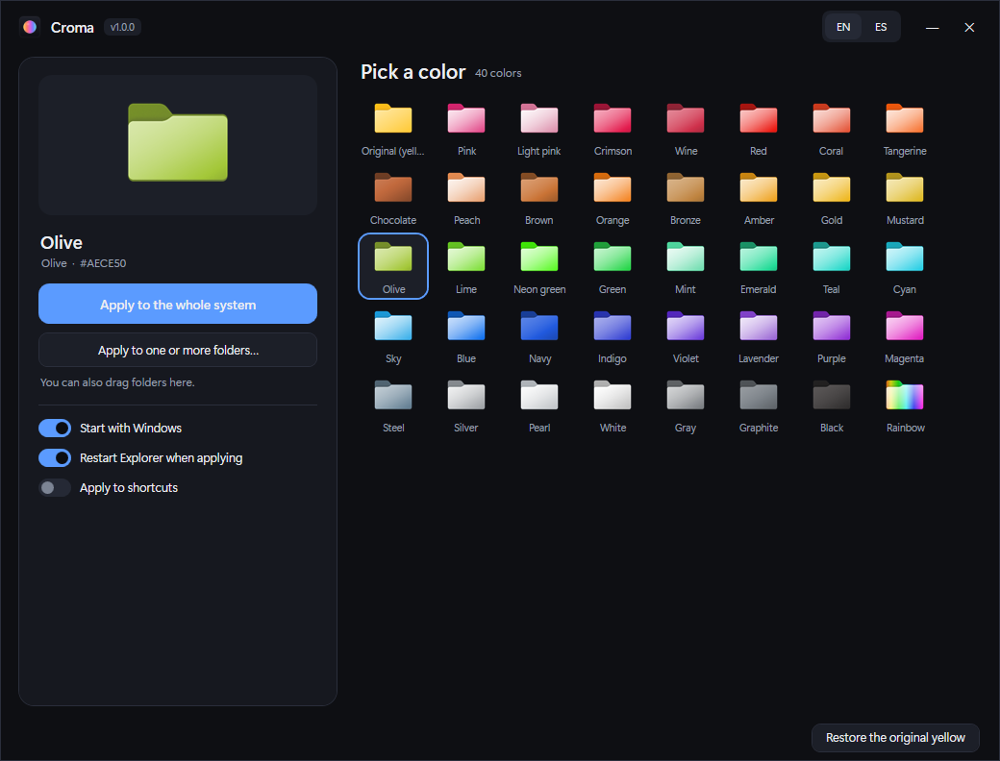

# Croma

Croma changes the colour of Windows folders. It recolours the real Windows 11 folder
icon instead of drawing a replacement, so the gloss, the shading and the depth stay
where Microsoft put them.



Tray application, starts with Windows, English and Spanish. Windows 10 and 11.

## Features

- 40 colours: the original yellow, reds, oranges, greens, blues, greys, pastels,
  neons and a rainbow gradient.
- One colour for the whole system, applied to Explorer, the desktop, drives and the
  folder dialogs.
- Per-folder colours from the context menu, which override the global one.
- Drag and drop folders onto the window to paint several at once.
- Colours survive reboots; anything Windows loses is repaired on the next start.
- Restore the original yellow in one click, registry included.

## How it works

Windows keeps folder icons in two different places, so there are two mechanisms.

**Global colour.** The icon comes from `HKLM\...\Explorer\Shell Icons` and
`HKLM\Software\Classes\Directory\DefaultIcon`. Both need administrator rights, which
is why every colour change asks for UAC.

**Per-folder colour.** Croma writes a hidden `desktop.ini` with an `IconResource`
line pointing at the colour's `.ico` file and sets the read-only attribute so Explorer
actually picks it up. No administrator rights, no system files touched.

The annoying part is the icon cache. Explorer caches folder icons per path and ignores
changes to `desktop.ini`: `SHChangeNotify` (sync and async), `SHCNE_UPDATEITEM`,
touching the folder timestamp and `ie4uinit.exe -show` all failed here, checked against
screenshot hashes. Clearing the cache and restarting Explorer is the only reliable
way, which is why applying a colour makes the taskbar blink for a second. There is an
option to skip the restart if you prefer stale icons.

## Install

Download `Croma.exe` from [Releases](../../releases) and run it. Requirements: Windows
10 or 11, 64-bit, and the
[.NET 10 Desktop Runtime](https://dotnet.microsoft.com/download/dotnet/10.0).

The first run creates the tray icon, the autostart entry, the desktop shortcut and the
context menu item. It also writes the 40 `.ico` files to `Pictures\FolderHue Icons` and
keeps its settings in `%LOCALAPPDATA%\FolderHue`. Those two paths are from before the
application was called Croma and stayed as they were so existing installs keep working.

## Usage

**The whole system:** open Croma from the tray, pick a colour and press *Apply to the
whole system*, then accept the UAC prompt.

**One folder:** right-click it, *Folder color*, pick a colour. On Windows 11 that
entry is under *Show more options* unless you hold Shift while right-clicking.

**Several folders:** select them, Shift+right-click, pick a colour. Or drag them onto
the Croma window and press the button.

## The icons, by hand

`Pictures\FolderHue Icons` holds every colour as a multi-resolution `.ico` (16 to 256
px), regenerated whenever the palette changes. They work in any *Properties → Change
icon* dialog.

Windows does not allow recolouring the File Explorer icon on the taskbar: it belongs
to `explorer.exe`, a signed system binary that is always running. Pinning a folder
shortcut with one of these icons is the closest thing, and it looks the same:

1. Right-click the shortcut, *Properties → Change icon → Browse*.
2. Pick a colour from `Pictures\FolderHue Icons`.
3. *Pin to taskbar*.

Croma cannot do the last step. Windows 11 ignores programmatic pin requests and the
shell returns success while doing nothing.

## Limits

- The File Explorer taskbar icon cannot be recoloured, and neither can the Start menu
  entry. That requires patching `explorer.exe`.
- Individual files cannot get a colour badge. Windows has no per-file icon override;
  shell overlay extensions are a different, riskier project.

## Build

```powershell
git clone https://github.com/SoyAntonioJimenez/Croma.git
cd Croma
dotnet build src/Croma.App/Croma.App.csproj
```

- `src/Croma.Core`: extracts the folder icon from `shell32.dll`, maps its luminance
  onto a colour ramp and writes the multi-size `.ico` files.
- `src/Croma.App`: WPF interface, tray icon, context menu, registry and `desktop.ini`.
- `src/Croma.Cli`: the tool used to generate the palette and check icon extraction.

The palette is the table in `src/Croma.Core/FolderColor.cs`. Adding an entry there is
enough for the icons, the menu, the picker and the swatches to include it.

## License

MIT.
